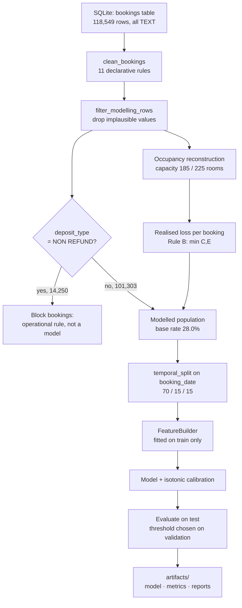

# Travelers' Inn — Cancellation Risk Pipeline

**Gautam Paramanantham** · gautamparam@gmail.com

AIAP® Batch 25 Technical Assessment. An end-to-end machine-learning pipeline that scores every new
booking for cancellation risk at the moment it is created, and converts that score into an
intervention priority the reservations desk can act on.

---

## 1. The problem, and why this one

The Head of Revenue & Reservations asked for help with three things: last-minute cancellations,
gut-feel room rates, and mixed guest feedback. Sizing them against each other (`eda.ipynb` §7) gave:

| Opportunity | Value | Confidence | Verdict |
|---|---|---|---|
| **Cancellations** | **~$3.0M / yr** | Moderate — rests on an inferred room capacity | **Build** |
| ADR mispricing | ~$0.9M / yr | Higher — benchmarked against the hotel's own comparable nights | Defer to phase two |
| Over-pricing on soft nights | ~$0 | High | Drop — no opportunity exists |

> **Problem statement.** For each new booking in the ~88% of volume where the outcome is genuinely
> uncertain, predict whether it will be honoured using only information available at booking time, and
> rank bookings for pre-arrival intervention by expected exposure — `P(cancel) × booking value`.

Two things in the EDA make this worth doing at all. Cancellations arrive with a **median 55 days of
notice**, not at the last minute as the brief assumed — so a score is a tool, not a post-mortem. And
the loss is real but far smaller than the raw numbers suggest: **$37.6M of gross cancelled value is
~$6.3M once re-sold room-nights and tour-operator block releases are removed.**

---

## 2. Folder structure

```
.
├── README.md                     this file
├── eda.ipynb                     Task 1 — exploratory data analysis (173 cells, executed)
├── decision_log.md               Task 2 — reasoning behind the work
├── prompt_chat_history.md        Task 4 — AI assistant transcripts
├── config.yaml                   every tunable decision, with its justification
├── run.sh                        pipeline runner (fetches the database if absent)
├── requirements.txt              pipeline dependencies only
├── src/                          Task 3 — the pipeline
│   ├── config.py                 YAML loading, dotted-key access, database path resolution
│   ├── data_access.py            read-only SQLite access
│   ├── cleaning.py               the declarative cleaning contract
│   ├── temporal.py               occupancy reconstruction and loss attribution
│   ├── features.py               feature engineering + the leakage guard
│   ├── splits.py                 chronological train/validation/test
│   ├── models.py                 model registry, encoders, calibration
│   ├── evaluate.py               statistical and business metrics
│   ├── profiling.py              before/after data-processing report
│   └── pipeline.py               orchestration and CLI entry point
├── tests/                        48 unit tests (pytest)
├── data/                         hotel.db lives here — NOT committed
└── artifacts/                    pipeline outputs — NOT committed
```

`src/cleaning.py` and `src/temporal.py` are imported by **both** `eda.ipynb` and the pipeline, so the
cleaning contract the notebook documents is the same object the pipeline executes. They cannot drift.

---

## 3. Running it

```bash
pip install -r requirements.txt     # once
bash run.sh                         # full pipeline, defaults from config.yaml
```

`run.sh` does **not** install dependencies — the GitHub Action does that before invoking it.

**The database.** `hotel.db` must not be committed, so it is absent in a fresh clone and in CI.
`run.sh` therefore downloads it from the assessment's published URL when missing, writing to a
temporary file first so an interrupted download cannot leave a truncated database behind. Local runs
skip this entirely because the file already exists.

```bash
TI_DB_PATH=/elsewhere/hotel.db bash run.sh    # use a database elsewhere
ALLOW_DOWNLOAD=0 bash run.sh                  # never fetch; fail if absent
```

### Changing parameters

Everything is in `config.yaml`, and any key can be overridden without editing the file:

```bash
bash run.sh --set model.name=logistic              # swap the algorithm
bash run.sh --set tuning.enabled=true              # run the hyper-parameter search
bash run.sh --set features.include_waiting_list=false   # ablate a suspect feature
bash run.sh --set population.exclude_block_bookings=false
bash run.sh --set intervention.budget=0.05         # tighter contact budget
bash run.sh --compare-all                          # every model in the registry
```

| Config key | Default | What it controls |
|---|---|---|
| `population.exclude_block_bookings` | `true` | Hold out the 14,250 tour-operator allotment holds (§8.1) |
| `population.exclude_event_period` | `false` | Drop the Feb–Mar 2024 demand event instead of flagging it |
| `features.winsorise_adr_quantile` | `0.99` | Where the ADR tail is clipped |
| `features.country_top_n` / `agent_top_n` | `15` / `20` | Category vocabulary sizes |
| `features.include_waiting_list` | `true` | Ablation switch for a confounded feature (§8.6) |
| `split.train_frac` / `val_frac` | `0.70` / `0.15` | Chronological split points |
| `model.name` | `hist_gbm` | `majority`, `value_sort`, `logistic`, `random_forest`, `hist_gbm` |
| `model.calibrate` | `true` | Isotonic probability calibration |
| `tuning.enabled` | `false` | Randomised search over time-ordered folds |
| `intervention.budget` | `0.10` | Share of bookings the desk can act on; sets the threshold |

### Tests

```bash
pytest tests/ -q      # 48 tests, ~4 seconds
```

Deliberately not wired into `run.sh`, which stays a pipeline runner.

---

## 4. Pipeline flow



Each stage is one method on `CancellationPipeline`, so they can be run individually from a notebook or
a test rather than only as one monolithic call.

---

## 5. Key EDA findings, and what the pipeline does about them

| # | Finding | Pipeline consequence |
|---|---|---|
| 1 | Cancellations are **not** last-minute — median 55 days' notice, only 14.2% inside 7 days | Justifies scoring at booking time; a score has ~2 months of runway |
| 2 | No capacity data exists, but daily occupancy plateaus at **185 / 225 rooms** | `temporal.infer_capacity` reconstructs it, enabling the loss metric |
| 3 | ~78% full overall, but **44–65% in Nov–Feb against 89–95% in May–Sep** | `season_band` feature; also why an identical cancellation costs ~4× more in the trough |
| 4 | Early March 2024 is a **demand event**, not dirt — ADR 10×, cancellations halved | ADR winsorised rather than dropped; `is_event_period` flag |
| 5 | `deposit_type = NON REFUND` cancels at **99.4%** — it marks allotment releases | Excluded as a feature *and* held out as a population |
| 6 | Three more columns are only known **after** booking | Excluded; `assert_no_leakage` enforces it in code |
| 7 | Only **55%** of empty room-nights trace to cancellations | Loss metric uses Rule B, not gross cancelled value |
| 8 | A last-minute-only target covers 22% of loss and is ~7 AUC points harder | Binary target kept; economics moved to the ranking rule |
| 10 | Short-notice cancellations are **1.5–3.7× less recoverable**, but their timing is not predictable | Not a feature; tracked as a diagnostic (§9) and answered by intervention timing, not by the model |
| 9 | Ranking by `P(cancel) × value` beats adding a seasonal weight | Simpler rule adopted — see §9 |
| 11 | Gradient boosting leads on PR-AUC but ties logistic on the business metric | Simpler model adopted — see §8.1 |

---

## 6. Train / validation / test split

Implemented in `src/splits.py`, invoked from `CancellationPipeline.split()`, and reported in the run
log and `artifacts/metrics.json` on every execution.

**The split is chronological on `booking_date`, never random.** This is the single most consequential
methodological choice in the pipeline, so it is worth stating plainly why:

A booking is scored *when it is created*, so the deployment reality is "train on bookings taken up to
today, score bookings taken tomorrow". A random split breaks that in two ways. It lets the model learn
a particular night's demand conditions from some of that night's bookings and then be tested on the
rest. And it hides concept drift by mixing periods together — drift the EDA measured directly, with
the cancellation rate running 37.5% → 29.9% across time-ordered periods of the raw data.

| Split | Share | Bookings | Period | Base rate | Purpose |
|---|---|---|---|---|---|
| Train | 70% | 70,982 | 2022-03-18 → 2024-11-17 | 27.7% | Fit |
| Validation | 15% | 15,283 | 2024-11-18 → 2025-02-13 | 29.0% | Tuning, calibration, threshold |
| Test | 15% | 14,991 | 2025-02-14 → 2025-08-31 | 28.2% | Reported once, at the end |

Cut points come from **quantiles** of `booking_date` rather than hard-coded dates, so the split stays
sensible if the extract is refreshed. Boundaries are written to `metrics.json` so any reported number
can be traced to the period it came from.

Three supporting details:

- **`booking_date`, not `arrival_date`.** Splitting on arrival would leak: a booking made today for
  next year's stay would land in test while its outcome was already known during training.
- **Rows without a usable date are dropped from all three splits** (47 bookings, from null lead
  times). Silently defaulting them into training would be worse than losing them.
- **Hyper-parameter tuning uses `TimeSeriesSplit`, not `KFold`.** Every tuning fold must also train on
  the past and validate on the future, or the search selects parameters that flatter a model which
  cannot generalise forward — a clean outer hold-out does not rescue a leaky inner loop.

The base-rate column above is the point of reporting the split at all: it exposes the drift a random
split would have concealed. `tests/test_splits.py` asserts the ordering property directly.

---

## 7. Feature processing

Only columns whose value is settled when a booking is created. **Six are excluded for leakage**, three
of them despite carrying the strongest apparent signal in the dataset.

| Feature / group | Source | Processing | Why this way |
|---|---|---|---|
| `lead_time`, `previous_cancellations`, `previous_bookings_not_canceled`, `is_repeated_guest`, `required_car_parking_spaces`, `total_of_special_requests` | raw | passthrough | Already numeric and admissible; no transform earns its complexity |
| `total_nights` | `stays_in_weekend_nights` + `stays_in_week_nights` | sum | Stay length is split across two columns in the source |
| `total_guests` | `adults` + `children` + `babies` | sum | Party size split across three columns |
| `adr_winsorised` | `adr` | clip at the **train-set** p99 | Max is $7,108. Clipped, not dropped: the $2,000+ tail is the March 2024 event — real demand, not error. Fitted on train only so the test period's prices cannot leak in |
| `booking_value` | `adr_winsorised × total_nights` | product | Half of the adopted ranking rule, so it is a first-class feature. Uses the *winsorised* rate — clipping only one would leave the outlier alive in the other |
| `lead_time_band` | `lead_time` | 5 bands | Cancellation climbs 9.8% → 56.2% monotonically. Trees find this unaided; a linear model cannot |
| `arrival_month`, `arrival_week`, `arrival_dow`, `is_weekend_arrival` | `arrival_date` | calendar parts | Fill rate swings 44%–95% across the year |
| `season_band` | `arrival_month` | peak / shoulder / trough | Encodes the ~4× difference in what a cancellation costs |
| `is_event_period` | `arrival_date` | boolean, 28 Feb – 12 Mar 2024 | A distinct pricing regime. Flagged rather than dropped so the model can learn that surges behave differently |
| `hotel`, `market_segment`, `distribution_channel`, `customer_type`, `meal`, `reserved_room_type` | raw | cleaned levels, `category` dtype | Cleaning collapses 26→3, 66→8 etc.; without it a one-hot encoder emits hundreds of near-empty columns |
| `country_grouped` | `country` | ISO/name aliases unified, top-15 by **train** frequency, rest → `OTH` | 140 raw values → 18 cleaned; the tail is still too thin to learn from |
| `agent_grouped`, `has_agent`, `has_company` | `agent`, `company` | missing → `NONE`; top-20 for agent | Missingness is **structural and informative** — a booking may genuinely have no agent — so it becomes a level, never an imputation |
| `promo_code` | raw | missing → `NONE` | Weak signal but admissible |
| `days_in_waiting_list` | raw | passthrough, **ablatable** | Admissible (known at confirmation) but ~98% sits in two market segments, so largely a proxy. Kept behind a switch rather than assumed either way |
| **EXCLUDED** | `deposit_type`, `assigned_room_type`, `booking_changes`, `reservation_status`, `reservation_status_date`, `client_email` | dropped | Not known at booking time. Enforced by `assert_no_leakage`, which raises rather than warns |

**Encoding differs by model family** — native `category` dtype for gradient boosting (no one-hot
needed), one-hot plus scaling for logistic regression (its penalty is scale-sensitive), ordinal for
random forest (trees split on thresholds, so the coding is arbitrary but harmless).

**Everything learned is fitted on train only**, inside a scikit-learn `Pipeline`, so train-only fitting
is enforced by the framework rather than by remembering to do it.

### Before/after data processing

`src/profiling.py` writes `artifacts/data_processing_report.md` on every run:

| Stage | Rows | Removed | Reason |
|---|---|---|---|
| Raw bookings table | 118,549 | — | — |
| After de-duplication | 118,196 | 353 | Duplicate `booking_id` |
| Usable for modelling | 115,553 | 2,643 | Non-positive ADR (2,061), zero nights (625), zero guests (187), implausible lead time (400) |
| **Modelled population** | **101,303** | 14,250 | Block bookings — handled by rule, not model |

**12 columns had their cardinality reduced; 402 spurious distinct values were absorbed.** The report
also cross-tabulates `is_canceled` against `reservation_status` — they agree on all 118,196 rows,
which is direct evidence the label survived cleaning intact.

---

## 8. Models

| Key | Model | Why it is in the registry |
|---|---|---|
| `majority` | Predicts the base rate | Demonstrates the accuracy trap — scores 0.72 while identifying nobody |
| `dummy_stratified` | Random scores | The statistical floor. `majority`'s constant score makes its *loss capture* degenerate (a constant times value reproduces the value ranking), so a genuinely random ranker is needed to floor that metric |
| `lead_time_rule` | **No ML** — rank by lead time | The heuristic a revenue manager would write, given that cancellation climbs 9.8% → 56.2% across lead-time bands |
| `value_sort` | **No ML** — rank by booking value | **The bar that matters.** A model that cannot beat it should not ship |
| `random_forest` | Random forest | Different inductive bias, as a cross-check |
| `logistic` | **Logistic regression, balanced** | **Chosen — see §8.1.** Interpretable, well calibrated, and statistically indistinguishable from boosting on the metric that decides anything |
| `hist_gbm` | Histogram gradient boosting | Wins the statistical metrics. Retained and evaluated every run; one flag away (`--set model.name=hist_gbm`) |

Tree ensembles use `HistGradientBoostingClassifier` rather than XGBoost or LightGBM deliberately: it
ships inside scikit-learn, so `requirements.txt` stays at six packages and the GitHub Action cannot
fail on a compiled dependency.

**Calibration is load-bearing here, not decorative.** The ranking rule multiplies the predicted
probability by dollars, so a miscalibrated probability produces a *wrong ordering*, not merely a
shifted one. Isotonic calibration is applied over time-ordered folds, and the Brier score is reported.

### 8.1 Why logistic regression and not gradient boosting

**Gradient boosting was the original choice, and it was wrong.** The EDA reasoning looked sound: no
numeric feature exceeds |0.30| Spearman correlation with the target while categorical levels differ
four-fold (§3.6), so the signal lives in interactions — exactly what a boosted ensemble captures and a
linear model does not. Boosting duly won the statistical metrics.

That reasoning went unchallenged until the question was put directly: *does the added complexity of
the gradient-boosted model actually earn its place?* Answering it properly meant comparing the two on
the **recoverability-weighted objective** rather than on PR-AUC, across budgets, with a confidence
interval. The result reversed the decision.

**Loss captured at budget** — the metric the business actually operates on:

| Intervention budget | logistic | hist_gbm | delta |
|---|---|---|---|
| 2% | **12.6%** | 11.6% | **−1.1%** |
| 5% | 24.8% | 25.4% | +0.7% |
| **10%** *(operating point)* | **40.4%** | 40.6% | **+0.2%** |
| 15% | 51.7% | 52.1% | +0.4% |
| 20% | 60.3% | **61.9%** | +1.6% |
| 30% | 75.6% | 75.7% | +0.1% |
| 50% | **91.9%** | 91.6% | −0.3% |

**Is that difference real?** Bootstrap over 2,000 resamples of the test set:

| Budget | hist_gbm − logistic | 95% CI | hist_gbm wins |
|---|---|---|---|
| 5% | +0.88% | **[−0.45%, +2.21%]** | 91% of resamples |
| **10%** | **+0.26%** | **[−0.92%, +1.48%]** | **68% of resamples** |
| 20% | +1.64% | [+0.34%, +2.99%] | 100% of resamples |

At the 10% operating point the interval straddles zero and boosting wins 68% of resamples — a lean,
not a difference. Only at a 20% budget does its advantage become statistically real, and even there it
is 1.6 points.

**Three places logistic is actively better:**

| | logistic | hist_gbm | Why it matters |
|---|---|---|---|
| Calibration (max gap) | **0.078** | 0.105 | The rule multiplies probability by dollars, so calibration error distorts the *ordering*, not just the scale. Both models were isotonically calibrated; logistic is still ~35% closer |
| Calibration (mean gap) | **0.036** | 0.054 | " |
| Airport Hotel, loss @10% | **45.3%** | 43.1% | A 2.1-point gap the blended figure hides |
| Artefact size | **0.05 MB** | 4.66 MB | 93× smaller |
| Scoring 1,000 bookings | **123 ms** | 186 ms | |

**Stability across four train/test cut dates** — logistic wins or ties at three of four:

| Cut date | logistic | hist_gbm | delta |
|---|---|---|---|
| 2024-08-01 | **40.2%** | 39.5% | −0.7% |
| 2024-11-01 | **40.3%** | 40.2% | −0.1% |
| 2025-01-01 | 40.3% | **40.9%** | +0.6% |
| 2025-04-01 | **44.9%** | 44.8% | −0.1% |

**What gradient boosting genuinely wins**, stated fairly:

- **PR-AUC 0.623 vs 0.581 and ROC-AUC 0.834 vs 0.819.** Real and consistent — but neither is the
  decision metric.
- **The 0–3 day notice band: 24.0% vs 20.4%.** The most expensive cancellations per booking, and the
  model's known blind spot (§9). A modest but genuine edge.
- **The 20% budget**, where its advantage is statistically significant.

**The decision.** Logistic regression becomes the default. Paying 93× the artefact size, worse
calibration and lost interpretability buys a difference indistinguishable from zero at the operating
point. Gradient boosting stays in the registry, is evaluated on every run, and is one flag away
(`--set model.name=hist_gbm`).

**Revisit this if either changes:** the desk's budget moves to 20%, where boosting's edge is real; or
the short-notice blind spot becomes the priority, where boosting is better. Both are recorded in §10.

This is the second time in this project that the simpler option won on evidence — the first was the
ranking rule, where adding a seasonal recoverability weight to `P(cancel) × value` made results worse.
Neither was obvious in advance; both took a direct measurement against the business objective to
settle.

---

## 9. Evaluation

### Why these metrics

**Accuracy is reported only to show it is useless.** The population is 72% honoured bookings, so
"predict nobody cancels" scores 0.72 and finds no one. It appears next to the `majority` baseline that
achieves exactly that, and is used for nothing.

**PR-AUC is the primary statistical metric.** At a 28% base rate the precision–recall curve describes
finding the minority class without being flattered by the large, easy negative class.

**Loss captured at budget is the primary business metric.** The desk can only contact so many guests,
so: of the money actually lost in the test period, what share sits in the top *k*% by score? Ground
truth is realised loss per booking (Rule B, §7.1), not gross cancelled value — three quarters of
cancelled room-nights were re-sold and cost nothing.

**Brier score** because probabilities get multiplied by dollars. **Per-hotel breakdown** because the
two properties differ materially and a blended figure would hide it.

### Results — held-out test set (14,991 bookings, booked Feb–Aug 2025)

| Model | PR-AUC | ROC-AUC | Brier | Accuracy | **Loss captured @10%** |
|---|---|---|---|---|---|
| **logistic (calibrated) — chosen** | 0.582 | 0.819 | 0.152 | 0.738 | **40.4%** |
| hist_gbm | **0.625** | **0.836** | **0.149** | 0.749 | 41.4% |
| random_forest | 0.593 | 0.810 | 0.154 | 0.745 | 38.9% |
| lead_time_rule *(no ML)* | 0.373 | 0.658 | 0.243 | 0.718 | 25.2% |
| value_sort *(no ML)* | 0.367 | 0.613 | 0.246 | 0.687 | 29.6% |
| dummy_stratified | 0.287 | 0.508 | 0.329 | 0.677 | 28.8% |
| majority | 0.282 | 0.500 | 0.202 | 0.282 | 29.6% |

The baselines confirm the model is doing real work: `dummy_stratified` sits at ROC-AUC 0.508 and
PR-AUC 0.287 — chance and the base rate respectively, exactly the floors theory predicts.

**One baseline result is worth pausing on.** `dummy_stratified` captures 28.8% of the loss despite
having no information at all. That is not a bug: the ranking is `P(cancel) × value`, so even a random
probability inherits the value signal. **The honest floor for loss capture is therefore ~29%, not
10%**, and the model's genuine contribution is the 12.6 points above it — not the 31 points above
random flagging that a naive reading would suggest.

Note also that `lead_time_rule` captures *less* loss (25.2%) than `value_sort` (29.6%) despite a
higher PR-AUC. Lead time is the best single predictor of *whether* a booking cancels, but says nothing
about *how much* that cancellation costs.

Reproduce with `bash run.sh --compare-all`.

Worth noting rather than hiding: **logistic regression captures slightly more loss at a 10% budget
than random forest does, despite a lower PR-AUC.** Ranking quality and loss capture are not the same
thing — the latter depends on getting the *expensive* bookings right, not merely the most numerous.
Gradient boosting leads on both, which is why it is chosen, but the discrepancy is a reminder that a
single metric would have picked differently.

**The chosen model is not the one that tops the statistical metrics.** Gradient boosting leads on
PR-AUC and ROC-AUC, but the two are statistically indistinguishable on loss capture at the operating
point — see §8.1 for the bootstrap intervals and the reasoning behind picking the simpler model.

**The honest margin is 10.8 points, not 40.** A one-line rule with no machine learning captures 29.6%
of the loss; the model adds 10.8 points on top. That is the number worth quoting, and it is why
`value_sort` is a permanent fixture of the registry rather than a footnote.

Loss capture across budgets, and the ranking rules compared (§9.5 tested all three):

| Intervention budget | 5% | 10% | 20% | 30% |
|---|---|---|---|---|
| Loss captured | 24.7% | **40.4%** | 60.3% | 75.6% |
| Lift over random | 4.9× | 4.0× | 3.0× | 2.5× |

| Ranking rule | Loss captured @10% |
|---|---|
| **`P(cancel) × value`** — adopted | **40.4%** |
| `booking_value` only | 29.6% |
| `P(cancel)` only | 26.7% |

Ranking on probability alone gives up ~14 points, because cancelled bookings are systematically more
valuable than honoured ones ($1,041 against $874). A seasonal recoverability weight was also tested and
**rejected** — it captured *less* at every budget, in 100% of bootstrap resamples.

### Where the "last-minute cancellations are costliest" finding went

The EDA established (§9.4) that short-notice cancellations are **1.5–3.7× less likely to be re-sold**
than early ones. That finding is *not* a feature and *not* a weight in the ranking rule, which is a
deliberate decision worth spelling out because the omission looks like an oversight.

**It cannot be a feature.** At booking time nobody knows when a guest will change their mind. §9.3
tested it directly: predicting *whether* a booking cancels reaches ROC-AUC 0.787, predicting whether
it will cancel *at short notice* only 0.716. Narrowing the target to short-notice cancellations also
covers just 22% of the loss, because those cancellations are only ~16% of the total.

**A seasonal proxy was tried and rejected.** Recoverability is largely driven by *when the stay falls*
— a January cancellation is lost 4× more often than a July one — and arrival date *is* known at
booking. So `P(cancel) × value × recoverability(month)` was tested. It captured **less** loss than
`P(cancel) × value` at every budget, on three cut dates, in 100% of bootstrap resamples: peak nights
carry high ADR *and* low loss probability, so the weight partly cancels the strongest available
signal. Recorded in §0 of the notebook as a rejected approach.

**Where it does appear — the evaluation ground truth.** `realised_loss_per_booking` uses Rule B,
`min(C, E)`, so a cancellation on a night that ended full contributes ~$0 and one on a soft night
contributes its full value. The model is therefore *selected* on a recoverability-weighted objective
even though recoverability is not an input. This captures the occupancy dimension of the finding; the
notice-period dimension it cannot, since the counterfactual treats cancellations within a night as
exchangeable.

**And as a diagnostic, which found a real blind spot.** `loss_capture_by_notice` asks whether the
model finds the costly cancellations or merely the frequent ones:

| Notice at cancellation | Realised loss | **Share captured @10% budget** |
|---|---|---|
| 0–3 days | $85,589 | **20.4%** |
| 4–7 days | $60,313 | **14.6%** |
| 8–14 days | $140,283 | 28.9% |
| 15–30 days | $196,794 | 37.1% |
| 31–60 days | $223,136 | 45.5% |
| 60+ days | $315,916 | **54.4%** |

**The model is markedly worse at the short-notice end** — capturing 15–20% of loss inside 7 days
against 46–54% beyond 30. (Gradient boosting is somewhat better here, 24.0% in the 0–3 day band
against logistic's 20.4%, which is the strongest argument in its favour — see §8.1.) It finds the cancellations that were always going to be visible early, and
misses precisely the least recoverable ones. That is a genuine limitation, not a tuning problem: the
features simply do not contain the information.

The operational consequence is the one the notebook reaches in §9.4b. Since short-notice cancellations
can be neither predicted nor prevented by a booking-time score, the lever is to **contact flagged
bookings early** and convert would-be late cancellations into early, recoverable ones. Success is then
measured on the *notice distribution* as well as the cancellation rate — which is why this diagnostic
is written to `metrics.json` on every run rather than computed once and forgotten.

### Per-property

| Property | Bookings | Base rate | PR-AUC | ROC-AUC |
|---|---|---|---|---|
| Airport Hotel | 5,324 | 25.6% | 0.626 | 0.860 |
| City Hotel | 9,667 | 29.6% | 0.564 | 0.804 |

The model works noticeably better at the Airport Hotel. Worth knowing before rollout, since the two
reservations teams are separate.

---

## 10. Deployment considerations

**Scoring.** The artefact is a single `joblib` pipeline taking a cleaned bookings frame and returning a
probability; feature engineering is inside it, so serving cannot drift from training. Scoring is
milliseconds per booking — it can run synchronously at booking creation.

**Retraining.** The base rate moved 27.7% → 29.0% → 28.2% across the three splits, and further back it
ranged 37.5% → 29.9%. That is real drift. Retrain quarterly, and monitor PR-AUC and the Brier score
between retrains — calibration will decay before discrimination does, and calibration is what the
ranking rule depends on.

**The block-booking rule is a separate code path.** 12.3% of bookings are tour-operator allotments
released ~99.4% of the time. They are excluded from the model deliberately, and production must route
them to a rule rather than silently scoring them — a classifier trained without them will be
overconfident on them.

**The action is not validated.** Nothing in this dataset shows that demanding a deposit changes guest
behaviour, and the break-even is tight: at a 10% budget the policy destroys value if it drives away
more than ~37% of guests who would have honoured, while ~33% of those flagged fall into that group.
Start with re-confirmation contact, which carries a far lower walk-away cost, and measure the
walk-away rate before scaling deposits.

**Capacity is inferred, not known.** Every loss figure scales with the 185/225 room estimate, which
failed its intended corroboration (§5.4). If the true room counts become available, the loss metric
should be recomputed before the business case is re-quoted.

**Fairness.** The model uses `country`. That is defensible for cancellation risk — travel distance
genuinely affects follow-through — but it means the intervention rate will differ by nationality.
Monitor flag rates per country group, and be prepared to justify or drop the feature; the EDA showed it
is not indispensable.

**Cold start.** New agents, countries and promo codes are folded into `OTHER_*` rather than raising, so
scoring degrades gracefully instead of failing.

**Two triggers to revisit the model choice.** Logistic regression was chosen over gradient boosting
because the two tied on the business metric at a 10% budget (§8.1). Boosting becomes the better
choice if either condition changes: the desk's intervention budget moves to ~20%, where its advantage
is statistically significant; or the short-notice blind spot becomes the operational priority, where
it captures 24.0% against logistic's 20.4%. Both models are evaluated on every run, so the comparison
stays current rather than being a one-off decision frozen in a README.

---

## 11. Notes on the other deliverables

- **`eda.ipynb`** — 173 cells, executed with outputs saved (the database is not committed, so an
  unexecuted notebook would open empty). Sections 0–12; §0 lists the seven decisions the notebook
  returns and the seven approaches that were tried and rejected.
- **`prompt_chat_history.md`** — ~79 KB across three sessions. Large but readable as one file, so it is
  kept inline rather than split into a folder.
- **`artifacts/`** — regenerated on every run; not committed.
